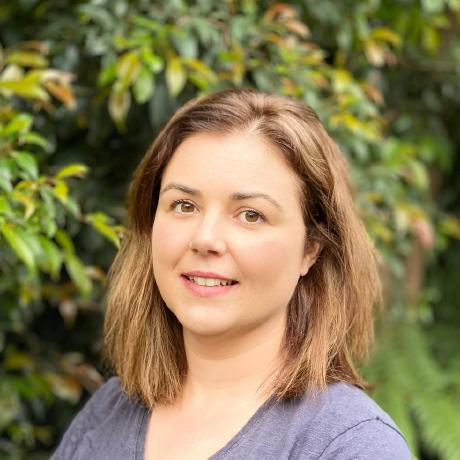

**Senior Bioinformatician (Academic Specialist), Australian BioCommons, University of Melbourne** 
Galaxy Australia: Science Lead · Product Owner, Genome Lab

Galaxy Australia is the national bioinformatics platform: 55,000+ users and 16 million+ analysis jobs (November 2026).

Background in field and museum biology (crustacean taxonomy, plant molecular systematics).

[ORCID](https://orcid.org/0000-0002-9906-0673) · [Google Scholar](https://scholar.google.com/citations?user=6FJP2ZkAAAAJ) · [GitHub](https://github.com/AnnaSyme) · [GTN profile](https://training.galaxyproject.org/hall-of-fame/annasyme/) · [WorkflowHub](https://workflowhub.eu/people/200) · Email: anna.syme [at] unimelb.edu.au

Sections: [Recent work](#recent-work) · [Career](#career) · [Education](#education) · [Publications](#publications) · [Books](#books) · [GTN tutorials](#galaxy-training-network-tutorials) · [Videos](#videos) · [WorkflowHub](#workflowhub-workflows) · [IWC](#iwc-workflows) · [Galaxy Australia workflows](#galaxy-australia-published-workflows) · [Zenodo](#zenodo-tutorials-and-datasets) · [Conferences](#conferences-seminars-workshops) · [Memberships and reviewing](#professional-memberships-and-reviewing) · [Community engagement](#community-engagement)

## Recent work

- The Genome Lab: designing a simpler interface for genome assembly and annotation. F1000Research 2026. [doi:10.12688/f1000research.191681.1](https://doi.org/10.12688/f1000research.191681.1)
- Mapping Artificial Intelligence in Galaxy Australia: Integration, Data Flows and Governance. eResearch Australasia 2026. [doi:10.5281/zenodo.23965924](https://doi.org/10.5281/zenodo.23965924)
- AI agent compared with expert-led conversion of a Nextflow pipeline to Galaxy. BioHackathon Europe 2026, project 31. Run report: [github.com/galaxyproject/iwc-lab/pull/17](https://github.com/galaxyproject/iwc-lab/pull/17)
- Community-curated Galaxy interfaces with the Galaxy Labs Engine. GigaScience 2026. The Genome Lab structure became the template for the Galaxy Labs Engine. [doi:10.1093/gigascience/giag041](https://doi.org/10.1093/gigascience/giag041)
- Asia-Pacific regional lead, Galaxy Training Academy: 3,500+ participants from 122 countries (2025).
- Galaxy Training Network tutorials (author or co-author): 235,000+ combined pageviews (December 2020 to November 2026).
- 40+ published workflows (WorkflowHub, IWC, Galaxy Australia).

## Career

- Senior Bioinformatician, Australian BioCommons, University of Melbourne, and Science Lead, Galaxy Australia (2020 to present)
- Research Scientist (Bioinformatics), Royal Botanic Gardens Victoria (2019 to 2020), for Genomics for Australian Plants. Chair, Reference Genomes and Bioinformatics Training working groups.
- Bioinformatician and National Training Manager, Galaxy Australia, Melbourne Bioinformatics, University of Melbourne (2016 to 2019)
- Molecular Systematist and Molecular Laboratory Manager, Royal Botanic Gardens Victoria (2010 to 2012)
- Postdoctoral Research Fellow, University of California Santa Barbara, USA (2007 to 2008)
- Relocation Officer and Laboratory Manager, Heritage Victoria (2002 to 2003)
- Assistant Collection Manager (Invertebrate Zoology) and Relocation Coordinator, Museum Victoria (1999 to 2001)

## Education

- PhD, Zoology, University of Melbourne (2007). Thesis: A Systematic Revision of the Cylindroleberididae (Crustacea: Ostracoda: Myodocopa). [minerva-access.unimelb.edu.au/items/c2d1a62c-1c48-58f5-914b-21d2065f452b](https://minerva-access.unimelb.edu.au/items/c2d1a62c-1c48-58f5-914b-21d2065f452b)
- BSc (Hons), Zoology, University of Melbourne (1999), first-class honours. Thesis (1998): Food limitation and daily ration of post-settlement King George whiting (*Sillaginodes punctatus*) in Port Phillip Bay.

## Publications

- **Syme AE**, Hyde CJ, Thang WCM, Mok W, Price GR. (2026). The Genome Lab: designing a simpler interface for genome assembly and annotation. F1000Research 15: 1825. [doi:10.12688/f1000research.191681.1](https://doi.org/10.12688/f1000research.191681.1)
- The Galaxy Community [incl. **Syme AE**]. (2026). Galaxy for accessible, reproducible, and collaborative data analyses: 2026 update. Nucleic Acids Research 54(W1): W105–W116. [doi:10.1093/nar/gkag469](https://doi.org/10.1093/nar/gkag469)
- Hyde C, **Syme AE**, Batut B, Zierep PF, Mok W, Bacon WA, Price GR. (2026). Community-curated Galaxy interfaces with the Galaxy Labs Engine. GigaScience 15: giag041. [doi:10.1093/gigascience/giag041](https://doi.org/10.1093/gigascience/giag041)
- Simpson L, et al. [incl. **Syme AE**]. (2025). The Genomics for Australian Plants (GAP) framework initiative – developing genomic resources for understanding the evolution and conservation of the Australian flora. Australian Systematic Botany 38(3). [doi:10.1071/SB24022](https://doi.org/10.1071/SB24022)
- The Galaxy Community [incl. **Syme AE**]. (2024). The Galaxy platform for accessible, reproducible, and collaborative data analyses: 2024 update. Nucleic Acids Research 52(W1): W83–W94. [doi:10.1093/nar/gkae410](https://doi.org/10.1093/nar/gkae410)
- Brown T, et al. [incl. **Syme AE**]. (2024). Genome annotation and other post-assembly workflows for the Tree of Life. BioHackrXiv preprint. [doi:10.37044/osf.io/fy49g](https://doi.org/10.37044/osf.io/fy49g)
- Mu A, et al. [incl. **Syme AE**]. (2023). Integrative omics identifies conserved and pathogen-specific responses of sepsis-causing bacteria. Nature Communications 14: 1530. [doi:10.1038/s41467-023-37200-w](https://doi.org/10.1038/s41467-023-37200-w)
- Hiltemann S, et al. [incl. **Syme AE**]. (2023). Galaxy Training: a powerful framework for teaching! PLOS Computational Biology 19(1): e1010752. [doi:10.1371/journal.pcbi.1010752](https://doi.org/10.1371/journal.pcbi.1010752)
- The Galaxy Community [incl. **Syme AE**]. (2022). The Galaxy platform for accessible, reproducible and collaborative biomedical analyses: 2022 update. Nucleic Acids Research 50(W1): W345–W351. [doi:10.1093/nar/gkac247](https://doi.org/10.1093/nar/gkac247)
- **Syme AE**, McLay TGB, Udovicic F, Cantrill DJ, Murphy DJ. (2021). Long-read assemblies reveal structural diversity in genomes of organelles – an example with *Acacia pycnantha*. Gigabyte. [doi:10.46471/gigabyte.36](https://doi.org/10.46471/gigabyte.36)
- Georgeson P, **Syme AE**, et al. (2019). Bionitio: demonstrating and facilitating best practices for bioinformatics command-line software. GigaScience 8(9): giz109. [doi:10.1093/gigascience/giz109](https://doi.org/10.1093/gigascience/giz109)
- Minhas V, et al. [incl. **Syme AE**]. (2019). Capacity to utilize raffinose dictates pneumococcal disease phenotype. mBio 10(1): e02596-18. [doi:10.1128/mBio.02596-18](https://doi.org/10.1128/mBio.02596-18)
- Foster CSP, et al. [incl. **Syme AE**]. (2016). Molecular phylogenetics provides new insights into the systematics of *Pimelea* and *Thecanthes* (Thymelaeaceae). Australian Systematic Botany 29: 185–196. [doi:10.1071/SB16013](https://doi.org/10.1071/SB16013)
- McCallum AW, et al. [incl. **Syme AE**]. (2015). Productivity enhances benthic species richness along an oligotrophic Indian Ocean continental margin. Global Ecology and Biogeography 24(4): 462–471. [doi:10.1111/geb.12255](https://doi.org/10.1111/geb.12255)
- Poore GCB, et al. [incl. **Syme AE**]. (2015). Invertebrate diversity of the unexplored marine western margin of Australia: taxonomy and implications for global biodiversity. Marine Biodiversity 45(2): 271–286. [doi:10.1007/s12526-014-0255-y](https://doi.org/10.1007/s12526-014-0255-y)
- **Syme AE**, Udovicic F, Stajsic V, Murphy DJ. (2013). A test of sequence-matching algorithms for a DNA barcode database of invasive grasses. DNA Barcodes 1: 19–26. [doi:10.2478/dna-2012-0002](https://doi.org/10.2478/dna-2012-0002)
- **Syme AE**, Oakley TH. (2012). Dispersal between shallow and abyssal seas and evolutionary loss and regain of compound eyes in cylindroleberidid ostracods: conflicting conclusions from different comparative methods. Systematic Biology 61(2): 314–336. [doi:10.1093/sysbio/syr085](https://doi.org/10.1093/sysbio/syr085)
- **Syme AE**. (2012). Diversification rates in the Australasian endemic grass *Austrostipa* – 15 million years of constant evolution. Plant Systematics and Evolution 298(1): 221–227. [doi:10.1007/s00606-011-0539-7](https://doi.org/10.1007/s00606-011-0539-7)
- **Syme AE**, Murphy DJ, Holmes GD, Gardner S, Fowler R, Cantrill DJ. (2012). An expanded phylogenetic analysis of *Austrostipa* (Poaceae: Stipeae) to test infrageneric relationships. Australian Systematic Botany 25: 1–10. [doi:10.1071/SB10049](https://doi.org/10.1071/SB10049)
- Lebel T, **Syme AE**. (2012). Sequestrate species of *Agaricus* and *Macrolepiota* from Australia: new combinations and species, and their position in a calibrated phylogeny. Mycologia 104: 496–520. [doi:10.3852/11-092](https://doi.org/10.3852/11-092)
- Jenkins GP, **Syme AE**, Macreadie PI. (2011). Feeding ecology of King George whiting *Sillaginodes punctatus* recruits in seagrass and unvegetated habitats. Journal of Fish Biology 78: 1561–1573. [doi:10.1111/j.1095-8649.2011.02962.x](https://doi.org/10.1111/j.1095-8649.2011.02962.x)
- Rivera AS, et al. [incl. **Syme AE**]. (2010). Gene duplication and the origins of morphological complexity in pancrustacean eyes, a genomic approach. BMC Evolutionary Biology 10: 123. [doi:10.1186/1471-2148-10-123](https://doi.org/10.1186/1471-2148-10-123)
- **Syme AE**, Poore GCB. (2008). A supplementary description of *Cypridina mariae*, type species of *Cylindroleberis*, and rediagnosis of the genus (Ostracoda: Myodocopa: Cylindroleberididae). PLoS ONE 3(4): e1960. [doi:10.1371/journal.pone.0001960](https://doi.org/10.1371/journal.pone.0001960)
- Lum KE, **Syme AE**, Schwab AK, Oakley TH. (2008). *Euphilomedes chupacabra* (Ostracoda: Myodocopida: Philomedidae), a new demersal marine species from coastal Puerto Rico with male-biased vespertine swimming activity. Zootaxa 1684: 35–57. [doi:10.11646/zootaxa.1684.1.2](https://doi.org/10.11646/zootaxa.1684.1.2)
- **Syme AE**, Poore GCB. (2006). Three new ostracod species from coastal Australian waters (Crustacea: Ostracoda: Myodocopa: Cylindroleberididae). Zootaxa 1305: 51–67. [doi:10.11646/zootaxa.1305.1.5](https://doi.org/10.11646/zootaxa.1305.1.5)
- **Syme AE**, Poore GCB. (2006). A checklist of species of Cylindroleberididae (Crustacea: Ostracoda). Museum Victoria Science Reports 9: 1–20. [doi:10.24199/j.mvsr.2006.09](https://doi.org/10.24199/j.mvsr.2006.09)

## Books

- Wilson R, Norman M, **Syme AE**. (2007). An Introduction to Marine Life. Museum Victoria / CSIRO Publishing. 144 pp. ISBN: 9780975837054.
- Poore GCB, **Syme AE**. (2009). Barnacles. Museum Victoria / CSIRO Publishing. 36 pp. ISBN: 9780980381351.

## Galaxy Training Network tutorials

Galaxy Training Network tutorials (author or co-author): 235,000+ combined pageviews, December 2020 to November 2026.

- **Syme AE**, Soranzo N. ***A short introduction to Galaxy*** (Galaxy Training Materials). Rated 4.8 out of 5 by 850+ learners (November 2026). [https://training.galaxyproject.org/training-material/topics/introduction/tutorials/galaxy-intro-short/tutorial.html](https://training.galaxyproject.org/training-material/topics/introduction/tutorials/galaxy-intro-short/tutorial.html)
- **Syme AE**. ***Chloroplast genome assembly*** (Galaxy Training Materials). [https://training.galaxyproject.org/training-material/topics/assembly/tutorials/chloroplast-assembly/tutorial.html](https://training.galaxyproject.org/training-material/topics/assembly/tutorials/chloroplast-assembly/tutorial.html)
- **Syme AE**. ***Large genome assembly and polishing*** (Galaxy Training Materials). [https://training.galaxyproject.org/training-material/topics/assembly/tutorials/largegenome/tutorial.html](https://training.galaxyproject.org/training-material/topics/assembly/tutorials/largegenome/tutorial.html)
- Lariviere D, et al. [incl. **Syme AE**]. ***Vertebrate genome assembly using HiFi, Bionano and Hi-C data - Step by Step*** (Galaxy Training Materials). [https://training.galaxyproject.org/training-material/topics/assembly/tutorials/vgp_genome_assembly/tutorial.html](https://training.galaxyproject.org/training-material/topics/assembly/tutorials/vgp_genome_assembly/tutorial.html)
- **Syme AE**, Seemann T, Gladman S. ***Genome annotation with Prokka*** (Galaxy Training Materials). [https://training.galaxyproject.org/training-material/topics/genome-annotation/tutorials/annotation-with-prokka/tutorial.html](https://training.galaxyproject.org/training-material/topics/genome-annotation/tutorials/annotation-with-prokka/tutorial.html)
- **Syme AE**, Gladman S, Seemann T. ***Microbial Variant Calling*** (Galaxy Training Materials). [https://training.galaxyproject.org/training-material/topics/variant-analysis/tutorials/microbial-variants/tutorial.html](https://training.galaxyproject.org/training-material/topics/variant-analysis/tutorials/microbial-variants/tutorial.html)
- GTN contributor profile: [training.galaxyproject.org/hall-of-fame/annasyme/](https://training.galaxyproject.org/hall-of-fame/annasyme/)

## Videos

YouTube recordings. View counts as at November 2026.

- **Syme AE**. (2024). Galaxy Top Tips: saving time when uploading data. Australian BioCommons. [youtube.com/watch?v=eSBQP81NrQw](https://www.youtube.com/watch?v=eSBQP81NrQw)
- **Syme AE**. (2024). Galaxy Top Tips: automate your data analyses with workflows. Australian BioCommons. [youtube.com/watch?v=sMUMs8JNLkU](https://www.youtube.com/watch?v=sMUMs8JNLkU)
- **Syme AE**. (2023). Large genome assembly and polishing. Galaxy Training Network tutorial recording. [youtube.com/watch?v=BM70nvwWjOY](https://www.youtube.com/watch?v=BM70nvwWjOY)
- **Syme AE**. (2021). Chloroplast genome assembly. Galaxy Training Network tutorial recording. 1,900+ views. [youtube.com/watch?v=eyfCyINTD_E](https://www.youtube.com/watch?v=eyfCyINTD_E)
- **Syme AE**, et al. (2021). Assembling reference genomes for Australian species. Webinar (one of the speakers; talk: why we want to assemble large genomes, and the challenges with assembly). Australian BioCommons. [youtube.com/watch?v=Eccxk3F6xdg](https://www.youtube.com/watch?v=Eccxk3F6xdg)
- **Syme AE**. (2020). Plant genomics: chloroplast genome assembly using Galaxy Australia. Webinar (presenter). Australian BioCommons. 1,900+ views. [youtube.com/watch?v=Z4x90JraT-4](https://www.youtube.com/watch?v=Z4x90JraT-4)
- **Syme AE**. (2018). Genome assembly and annotation with Galaxy Australia. Workshop recording (lead trainer), National Hybrid Training, EMBL-ABR and Galaxy Australia. 18,000+ views. [youtube.com/watch?v=K2HqLzTlaDw](https://www.youtube.com/watch?v=K2HqLzTlaDw)
- **Syme AE**. (2018). 16S metagenomics with Galaxy Australia. Workshop recording (lead trainer), National Hybrid Training, EMBL-ABR and Galaxy Australia. 7,600+ views. [youtube.com/watch?v=KG7k2jRdqEo](https://www.youtube.com/watch?v=KG7k2jRdqEo)
- **Syme AE**. (2018). Differential gene expression from RNA-seq using Galaxy Australia. Workshop recording (lead trainer), National Hybrid Training, EMBL-ABR and Galaxy Australia. 5,000+ views. [youtube.com/watch?v=XL2Zjxe3NFw](https://www.youtube.com/watch?v=XL2Zjxe3NFw)

## WorkflowHub workflows

24 workflows on WorkflowHub: [workflowhub.eu/people/200/workflows](https://workflowhub.eu/people/200/workflows)

- **Syme AE**. (2021). Data QC. WorkflowHub. [https://doi.org/10.48546/workflowhub.workflow.222.1](https://doi.org/10.48546/workflowhub.workflow.222.1)
- **Syme AE**. (2021). kmer counting - Meryl. WorkflowHub. [https://doi.org/10.48546/workflowhub.workflow.223.1](https://doi.org/10.48546/workflowhub.workflow.223.1)
- **Syme AE**. (2021). Trim and filter reads - Fastp. WorkflowHub. [https://doi.org/10.48546/workflowhub.workflow.224.1](https://doi.org/10.48546/workflowhub.workflow.224.1)
- **Syme AE**. (2021). Assembly with Flye. WorkflowHub. [https://doi.org/10.48546/workflowhub.workflow.225.1](https://doi.org/10.48546/workflowhub.workflow.225.1)
- **Syme AE**. (2021). Assembly polishing. WorkflowHub. [https://doi.org/10.48546/workflowhub.workflow.226.1](https://doi.org/10.48546/workflowhub.workflow.226.1)
- **Syme AE**. (2021). Racon polish with long reads, x4. WorkflowHub. [https://doi.org/10.48546/workflowhub.workflow.227.1](https://doi.org/10.48546/workflowhub.workflow.227.1)
- **Syme AE**. (2021). Racon polish with Illumina reads, x2. WorkflowHub. [https://doi.org/10.48546/workflowhub.workflow.228.1](https://doi.org/10.48546/workflowhub.workflow.228.1)
- **Syme AE**. (2021). Assess genome quality. WorkflowHub. [https://doi.org/10.48546/workflowhub.workflow.229.1](https://doi.org/10.48546/workflowhub.workflow.229.1)
- **Syme AE**. (2021). Combined workflows for large genome assembly. WorkflowHub. [https://doi.org/10.48546/workflowhub.workflow.230.1](https://doi.org/10.48546/workflowhub.workflow.230.1)
- **Syme AE**. (2022). QC of RADseq reads. WorkflowHub. [https://workflowhub.eu/workflows/346](https://workflowhub.eu/workflows/346)
- **Syme AE**. (2022). Stacks RAD-seq reference-guided workflow. WorkflowHub. [https://workflowhub.eu/workflows/347](https://workflowhub.eu/workflows/347)
- **Syme AE**. (2022). Stacks RAD-seq de novo workflow. WorkflowHub. [https://workflowhub.eu/workflows/348](https://workflowhub.eu/workflows/348)
- **Syme AE**. (2022). Partial de novo workflow: ustacks only. WorkflowHub. [https://workflowhub.eu/workflows/349](https://workflowhub.eu/workflows/349)
- **Syme AE**. (2022). Partial de novo workflow: c-s-g-pops only. WorkflowHub. [https://workflowhub.eu/workflows/350](https://workflowhub.eu/workflows/350)
- **Syme AE**. (2022). Partial ref-guided workflow - bwa mem only. WorkflowHub. [https://workflowhub.eu/workflows/351](https://workflowhub.eu/workflows/351)
- **Syme AE**. (2022). Partial ref-guided workflow - gstacks and pops. WorkflowHub. [https://workflowhub.eu/workflows/352](https://workflowhub.eu/workflows/352)
- Silver L, **Syme AE**. (2024). QC and trimming of RNAseq reads - TSI. WorkflowHub. [https://doi.org/10.48546/workflowhub.workflow.876.1](https://doi.org/10.48546/workflowhub.workflow.876.1)
- Silver L, **Syme AE**. (2024). Find transcripts - TSI. WorkflowHub. [https://doi.org/10.48546/workflowhub.workflow.877.1](https://doi.org/10.48546/workflowhub.workflow.877.1)
- Silver L, **Syme AE**. (2024). Combine transcripts - TSI. WorkflowHub. [https://doi.org/10.48546/workflowhub.workflow.878.1](https://doi.org/10.48546/workflowhub.workflow.878.1)
- Silver L, **Syme AE**. (2024). Extract transcripts - TSI. WorkflowHub. [https://doi.org/10.48546/workflowhub.workflow.879.1](https://doi.org/10.48546/workflowhub.workflow.879.1)
- Silver L, **Syme AE**. (2024). Convert formats - TSI. WorkflowHub. [https://doi.org/10.48546/workflowhub.workflow.880.1](https://doi.org/10.48546/workflowhub.workflow.880.1)
- Silver L, **Syme AE**. (2024). Repeat masking - TSI. WorkflowHub. [https://doi.org/10.48546/workflowhub.workflow.875.3](https://doi.org/10.48546/workflowhub.workflow.875.3)
- **Syme AE**. (2024). Genome assembly workflow for nanopore reads, for TSI. WorkflowHub. [https://doi.org/10.48546/workflowhub.workflow.1114.1](https://doi.org/10.48546/workflowhub.workflow.1114.1)
- Farquharson K, Price G, Tang S, **Syme AE**. (2024). Genome-assessment-post-assembly. WorkflowHub. [https://doi.org/10.48546/workflowhub.workflow.403.7](https://doi.org/10.48546/workflowhub.workflow.403.7)

## IWC workflows

- **Syme AE**. (2024). Assembly with Flye. Galaxy workflow, Intergalactic Workflow Commission (IWC). [https://workflowhub.eu/workflows/750](https://workflowhub.eu/workflows/750)
- **Syme AE**. (2023). Polish with long reads. Galaxy workflow, Intergalactic Workflow Commission (IWC). [https://workflowhub.eu/workflows/563](https://workflowhub.eu/workflows/563)

## Galaxy Australia published workflows

Owner and creator: **Syme AE**.

- Create manifest for fastq files for Qiime2 (2025). [https://usegalaxy.org.au/u/annasyme/w/create-manifest-for-fastq-files-for-qiime2](https://usegalaxy.org.au/u/annasyme/w/create-manifest-for-fastq-files-for-qiime2)
- QC of Illumina data (2025). [https://usegalaxy.org.au/u/annasyme/w/qc-illumina-data](https://usegalaxy.org.au/u/annasyme/w/qc-illumina-data)
- Combined fungi assembly and annotation workflow - Version 1 (2024). [https://usegalaxy.org.au/published/workflow?id=7c99dc849c7b9a6e](https://usegalaxy.org.au/published/workflow?id=7c99dc849c7b9a6e)
- Conditional workflows simple example - Version 1 (2024). [https://usegalaxy.org.au/u/annasyme/w/copy-of-demo-workflow-for-conditional-statements-1](https://usegalaxy.org.au/u/annasyme/w/copy-of-demo-workflow-for-conditional-statements-1)
- Create pairwise FASTA list (2024). [https://usegalaxy.org.au/u/annasyme/w/create-pairwise-fasta-list](https://usegalaxy.org.au/u/annasyme/w/create-pairwise-fasta-list)
- Demonstration conditional workflow (2024). [https://usegalaxy.org.au/u/annasyme/w/demonstration-conditional-workflow](https://usegalaxy.org.au/u/annasyme/w/demonstration-conditional-workflow)
- Examples of optional and restricted inputs - Version 1 (2024). [https://usegalaxy.org.au/u/annasyme/w/examples-of-optional-and-restricted-inputs](https://usegalaxy.org.au/u/annasyme/w/examples-of-optional-and-restricted-inputs)
- Fungi: Assembly QC, Blast, RagTag - Version 1 (2024). [https://usegalaxy.org.au/u/annasyme/w/fungi-assembly-qc](https://usegalaxy.org.au/u/annasyme/w/fungi-assembly-qc)
- Fungi: Illumina data QC and assembly - Version 1 (2024). [https://usegalaxy.org.au/u/annasyme/w/fungi-illumina-assembly](https://usegalaxy.org.au/u/annasyme/w/fungi-illumina-assembly)
- Fungi: repeat masking, annotation with Helixer, Funannotate, Fgenesh (2024). [https://usegalaxy.org.au/u/annasyme/w/fungi-annotation](https://usegalaxy.org.au/u/annasyme/w/fungi-annotation)
- Pre-Alphafold workflow to create list of target-candidate pairs - Version 1 (2024). [https://usegalaxy.org.au/u/annasyme/w/create-target-candidate-pairs](https://usegalaxy.org.au/u/annasyme/w/create-target-candidate-pairs)
- Run a tool if more than x reads - Version 1 (2024). [https://usegalaxy.org.au/u/annasyme/w/copy-of-demonstration-conditional-workflow](https://usegalaxy.org.au/u/annasyme/w/copy-of-demonstration-conditional-workflow)
- What is in my sequencing reads? - Version 1 (2024). [https://usegalaxy.org.au/u/annasyme/w/what-is-in-my-sequencing-reads](https://usegalaxy.org.au/u/annasyme/w/what-is-in-my-sequencing-reads)
- Workflow example with workflow report - Version 1 (2024). [https://usegalaxy.org.au/u/annasyme/w/workflow-example-with-workflow-report](https://usegalaxy.org.au/u/annasyme/w/workflow-example-with-workflow-report)
- Assembly polishing (2021). [https://usegalaxy.org.au/u/annasyme/w/assembly-polishing](https://usegalaxy.org.au/u/annasyme/w/assembly-polishing)
- Assembly with Flye (2021). [https://usegalaxy.org.au/u/annasyme/w/assembly-with-flye](https://usegalaxy.org.au/u/annasyme/w/assembly-with-flye)
- Assess genome quality (2021). [https://usegalaxy.org.au/u/annasyme/w/assess-genome](https://usegalaxy.org.au/u/annasyme/w/assess-genome)
- Combined workflows for large genome assembly (2021). [https://usegalaxy.org.au/u/annasyme/w/combined-large-genome-workflow](https://usegalaxy.org.au/u/annasyme/w/combined-large-genome-workflow)
- Data QC (2021). [https://usegalaxy.org.au/u/annasyme/w/data-qc](https://usegalaxy.org.au/u/annasyme/w/data-qc)
- kmer counting - meryl (2021). [https://usegalaxy.org.au/u/annasyme/w/kmer-counting-meryl](https://usegalaxy.org.au/u/annasyme/w/kmer-counting-meryl)
- Prepare test data - remove chloroplast reads and subsample to 10% (2021). [https://usegalaxy.org.au/u/annasyme/w/prepare-test-data-remove-chloro-subsample-10-pc](https://usegalaxy.org.au/u/annasyme/w/prepare-test-data-remove-chloro-subsample-10-pc)
- Racon polish with Illumina reads (R1 only), x2 (2021). [https://usegalaxy.org.au/u/annasyme/w/racon-polish-with-illumina-reads-x2](https://usegalaxy.org.au/u/annasyme/w/racon-polish-with-illumina-reads-x2)
- Racon polish with long reads, x4 (2021). [https://usegalaxy.org.au/u/annasyme/w/racon-polish-with-long-reads-x4](https://usegalaxy.org.au/u/annasyme/w/racon-polish-with-long-reads-x4)
- Trim and filter reads - fastp (2021). [https://usegalaxy.org.au/u/annasyme/w/trim-and-filter-reads-fastp](https://usegalaxy.org.au/u/annasyme/w/trim-and-filter-reads-fastp)

## Zenodo tutorials and datasets

- **Syme AE**. (2021). Tutorial: Assemble a large genome using Galaxy. Zenodo. [doi:10.5281/zenodo.5655813](https://doi.org/10.5281/zenodo.5655813) [327 downloads]
- **Syme AE**. (2020). Tutorial: Assemble and annotate a chloroplast genome. Zenodo. [doi:10.5281/zenodo.3971667](https://doi.org/10.5281/zenodo.3971667) [502 downloads]
- **Syme AE**. (2020). Chloroplast genome sequencing reads from snow gum [dataset]. Zenodo. [doi:10.5281/zenodo.3600662](https://doi.org/10.5281/zenodo.3600662) [267 downloads]
- **Syme AE**. (2019). Chloroplast genome sequencing reads from sweet potato [dataset]. Zenodo. [doi:10.5281/zenodo.3567224](https://doi.org/10.5281/zenodo.3567224) [3,686 downloads]
- Schwessinger B, et al. [incl. **Syme AE**]. (2024). BPA Functional Fungi bioinformatics workshop: training materials, 15 example histories and 6 workflows. Zenodo. [https://zenodo.org/records/14498677](https://zenodo.org/records/14498677) [2,700+ downloads, November 2026]

## Conferences, seminars, workshops

- **Syme AE**, Goudey B, Huynh M, Hyde C, Bromhead C, Thang M, Goonasekera N, Price GR. (2026). Mapping Artificial Intelligence in Galaxy Australia: Integration, Data Flows and Governance. Poster (presenter). eResearch Australasia 2026, Melbourne, 29 October 2026. [doi:10.5281/zenodo.23965924](https://doi.org/10.5281/zenodo.23965924)
- **Syme AE**. (2026). Converting a Nextflow pipeline to Galaxy with and without the Foundry. ELIXIR BioHackathon Europe 2026, project 31 (online), November 2026. Run report: [github.com/galaxyproject/iwc-lab/pull/17](https://github.com/galaxyproject/iwc-lab/pull/17)
- Nelson TM, et al. [incl. **Syme AE**] (2026). Poster (Nelson T presenter). Genomics infrastructure to support Australian researchers. 47th Lorne Genome Conference, Australia.
- **Syme AE**. (2024, 2025). Asia-Pacific regional lead, Galaxy Training Academy: 2,800+ participants in 2024; 3,500+ participants from 122 countries in 2025.
- **Syme AE**. (2025). Co-technical lead for Galaxy Australia, Singapore Biology League 2025 (online, 12 July 2025): about 500 student teams (2,000+ participants) used Galaxy Australia. [sgbioleague.org](https://sgbioleague.org)
- **Syme AE**. (2025). The Power of Workflows in Galaxy Australia. Talk with live demonstration. Australian BioCommons Genomics Community Meeting, March 2025.
- Price G, [Galaxy Australia team incl. **Syme AE**], et al. (2024). Talk (Price G presenter). State of Galaxy Australia. Galaxy Community Conference (GCC2024), Brno, Czech Republic, June 2024.
- Nelson TM, et al. [incl. **Syme AE**] (2024). Poster (Nelson T presenter). Establishing genomics infrastructure for Australian researchers. ELIXIR All-Hands Meeting, Uppsala, Sweden, June 2024; also shown at the Galaxy Community Conference (GCC2024). F1000Research 13(ELIXIR): 607. [doi:10.7490/F1000RESEARCH.1119744.1](https://doi.org/10.7490/F1000RESEARCH.1119744.1)
- Silver L, **Syme AE**, Ward N, Hogg C. (2024). Talk (Silver L presenter). Empowering Bioinformaticians and Conservation Managers: Generating Workflow Solutions in Galaxy. Genetics Society of Australasia Conference, Macquarie University, June 30 – July 3, 2024. [https://genetics.org.au/wp-content/uploads/2025/03/GSA24_AbstractBook_Oficial.pdf](https://genetics.org.au/wp-content/uploads/2025/03/GSA24_AbstractBook_Oficial.pdf)
- Connolly K, et al. [incl. **Syme AE**]. (2023, 2024). Galaxy Australia – making use of national and commercial GPGPU resources. Talk (co-author; Connolly K presenter). eResearch Australasia, Brisbane, October 2023; eResearch Australasia, Melbourne, October–November 2024.
- **Syme AE**. (2024). BPA Functional Fungi bioinformatics workshop (Fungal Genomics with Galaxy), Australian National University, Canberra, 29 to 31 October 2024 (hosted by Schwessinger B and McTaggart AR): ran the Galaxy training with Gareth Price for 38 researchers; wrote the six Galaxy workflows. Training materials: 2,700+ downloads (November 2026). [doi:10.5281/zenodo.14498676](https://doi.org/10.5281/zenodo.14498676)
- **Syme AE**, et al. (2023). Poster. Building a Galaxy Lab for genomics. Galaxy Community Conference (GCC2023), Brisbane, July 2023. Scientific Program Committee member.
- Brown T, et al. [incl. **Syme AE**]. (2023). Genome annotation workflows for the Tree of Life. BioHackathon Europe, Barcelona, October–November 2023. Led the Australian team on this project. Outputs: preprint [doi:10.37044/osf.io/fy49g](https://doi.org/10.37044/osf.io/fy49g)
- **Syme AE**, Bassetti M, Mok W, Hyde C, Ward N, Price G. (2023). Making bioinformatics more user-friendly with custom interfaces. Talk (Price G presenter). International Conference on Bioinformatics (InCoB), 2023.
- **Syme AE**. (2023). Melbourne Bioinformatics workshops: Introduction to Galaxy and Galaxy Workflows; Introduction to Galaxy and Quality Control. Workshops (presenter). Melbourne Bioinformatics, University of Melbourne, 2023.
- Price G, **Syme AE**. (2022). Bioinformatics Training: Galaxy Global Platform for the Analysis of SARS-CoV-2 Data and Variants. Training session. 53rd Meeting of the Asia Pacific Advanced Network (APAN53), Bangladesh (online/hybrid), 7 March 2022. Coordinated by eResearch Network for South East Asia (eRSEA). [apan53.apan.net](https://apan53.apan.net)
- **Syme AE**. (2022). Organising committee, Galaxy Smörgåsbord global training event.
- **Syme AE**, et al. (2021). Driving workforce transition in Australian life science research. Poster. Galaxy Community Conference (GCC2021), July 2021 (online). Scientific Program Committee member. Workshop (presenter): Genome Assembly – lecture and hands-on tutorial (**Syme AE**, Gladman S). [doi:10.7490/f1000research.1118591.1](https://doi.org/10.7490/f1000research.1118591.1)
- **Syme AE**. (2021). Assembling genomes on Galaxy Australia. Presentation. Australian BioCommons Showcase, Melbourne, 4 November 2021. Panelist: Galaxy Partnerships – Partnering with the international community (Ward N, Price G, Gladman S, **Syme AE**).
- **Syme AE**. (2021). What can long reads tell us about genome structure? Presentation. Melbourne Bioinformatics Group Meeting, March 2021.
- **Syme AE**. (2021). Asia/Pacific Facilitator for several multi-day international Galaxy workshops: Galaxy Smorgasbord training week (1,000+ participants); SARS-CoV-2 Data Analysis and Monitoring with Galaxy; Plant Transcriptomics with Galaxy.
- Pope B, et al. [incl. **Syme AE**]. (2020). Best practices in bioinformatics command-line software with Bionitio. Talk (co-author; Pope B presenter). ABACBS Annual Conference, November 2020 (online).
- **Syme AE**. (2020). What do researchers want to know? Presentation. Australian BioCommons BYOD Project Presentation, November 2020.
- Pope B, **Syme AE**. (2020). Bionitio – building better bioinformatics tools with batteries included. Workshop (co-presenter). Bioinformatics Community Conference (BCC2020), 18 July 2020.
- **Syme AE**. (2020). Chloroplast genome assembly using Galaxy Australia. Webinar. Australian BioCommons, 10 December 2020.
- Pope B, et al. [incl. **Syme AE**]. (2020). Bionitio. Talk (co-author; Pope B presenter). Bioinformatics Community Conference (BCC), July 2020 (online).
- **Syme AE**. (2020). GAP Reference Genomes Pilot. Presentation. BioPlatforms Australia Facilities Meeting, May 2020.
- Price G, et al. [incl. **Syme AE**]. (2019). Galaxy Australia – inside the national vision of a data commons. Talk (co-author; Price G presenter). Galaxy Community Conference (GCC2019), Freiburg, Germany, 2 July 2019. Session chair: Transcriptomics and Genomics (3 July 2019).
- Hiltemann S, et al. [incl. **Syme AE**]. (2019). Train the Galaxy Trainer. Workshop (co-presenter). Galaxy Community Conference (GCC2019), Freiburg, Germany, 3 July 2019.
- Lariviere D, **Syme AE**. (2019). Assembly and annotation of bacterial genomes. Workshop (co-presenter). Galaxy Community Conference (GCC2019), Freiburg, 4 July 2019.
- Session chair: Transcriptomics and Genomics. Galaxy Community Conference (GCC2019), Freiburg, Germany, July 2019.
- Session co-chair: Plant genomics. Australasian Genomic Technologies Association (AGTA) Conference, Melbourne, 8 October 2019.
- Pope B, **Syme AE**, Cameron D. (2018). Best practices in bioinformatics software development. Workshop (co-presenter). ABACBS Conference, Melbourne, 30 November 2018.
- Price G, et al. [incl. **Syme AE**]. (2018). Enabling Australian Genomics research through enhancements to the Genomics Virtual Lab. Talk (co-author; Price G presenter). eResearch Australasia Conference, Melbourne, October 2018.
- **Syme AE**. (2018). Long-read genome assembly. Workshop (presenter/developer). Melbourne Bioinformatics Genome Assembly Workshop, October 2018 (**Syme AE**, Seemann T, Gladman S) and March 2018 (**Syme AE**, Seemann T).
- **Syme AE**. (2018). National Hybrid Training. Workshop (developer and co-presenter). Galaxy Australia / Australian BioCommons, 2018. Four workshops across Australia: (1) Genome Assembly and Annotation, 22 August; (2) Finding Genetic Variants in Bacterial Sequence Data, 12 September; (3) Differential Gene Expression from Bacterial RNA-Seq Data, 23 October; (4) Metagenomics, 14 November. Facilitator Training for Hybrid Training, Melbourne, 26–27 July.
- Pope B, **Syme AE**. (2018). Bionitio for bioinformatics command-line software. Workshop (co-presenter). Melbourne Bioinformatics, July 2018.
- **Syme AE**, et al. (2017). Galaxy training for microbial genomics. Poster (presenter). ABACBS Annual Conference, Adelaide, November 2017.
- **Syme AE**. (2017). Building genomics tutorials in Galaxy, for biologists. Talk (presenter). Galaxy Australasia Meeting (GAMe), Melbourne, February 2017.
- Kwong JC, et al. [incl. **Syme AE**]. (2017). Combined genomic and epidemiological investigation of a state-wide, multi-institution outbreak of KPC-producing Enterobacteriaceae. Poster (co-author). European Congress of Clinical Microbiology and Infectious Diseases (ECCMID), Vienna, April 2017.
- **Syme AE**. (2017). Long-read genome assembly. Workshop (presenter/developer). Melbourne Bioinformatics Genome Assembly Workshop, October 2017.
- Gladman S, **Syme AE**. (2017). Galaxy, Assembly, Annotation, Useful tools, Moving data, Variant calling. Workshop (co-presenter). Genomics Workshop for Faculty of Veterinary and Agricultural Sciences, University of Melbourne, November 2017.
- Gladman S, **Syme AE**. (2017). Bacterial genomics using the Galaxy platform. Workshop (co-presenter). Genomics Workshop for Intersect, Sydney, December 2017.
- **Syme AE**. (2017). The Genomics Virtual Laboratory and Omics Platform. Workshop/demonstration (presenter). eResearch South Australia, Adelaide, April 2017.
- **Syme AE**. (2017). Genome size from k-mer counting. Melbourne Bioinformatics, September 2017.
- **Syme AE**. (2016). Using DNA to understand eye evolution. Melbourne Bioinformatics, June 2016.
- **Syme AE**. (2016). Complete genomes from long and short reads. Melbourne Bioinformatics, October 2016.
- **Syme AE**, Baines S, Bulach D, Seemann T. (2016). Complete genomes: the long and the short of it. Poster (presenter). ABACBS Annual Conference, Brisbane, November 2016. Best poster award (F1000). Published: F1000Research 5: 2589. [doi:10.7490/f1000research.1113338.1](https://doi.org/10.7490/f1000research.1113338.1)
- **Syme AE**, Seemann T, Gladman S, Bulach D, et al. (2016). RDS Omics Training Material – antibiotic resistant pathogens. Project update (presenter). RDS/BPA Omics Consortium Meeting, Melbourne, November 2016.
- Gladman S, **Syme AE**. (2016). A next-generation sequencing workshop: assembly, annotation, variant calling. Workshop (co-presenter). UWA Microbial Genomics Workshop, Perth, November 2016. Event: [combine.org.au](https://combine.org.au)
- **Syme AE**. (2011 to 2012). Co-convenor, Melbourne Systematics Forum.
- **Syme AE**, Stefani F. (2012). Phylogenetic methods using BEAST, R and Geneious. Presentation and workshop. Melbourne Systematics Forum, May 2012.
- **Syme AE**, Udovicic F. (2011). Investigating rbcL gene duplication in grasses. Talk (presenter). Session chair: Barcoding Grasses. Fourth International Barcode of Life Conference, Adelaide, 2011.
- **Syme AE**, Udovicic F. (2011). A multi-gene study of relationships within the Australian grass genus *Austrostipa*. Talk (presenter). XVIII International Botanical Congress, Melbourne, 2011.
- Udovicic F, **Syme AE**, Murphy D, Stajsic V. (2011). DNA barcodes for stipoid grasses: developing a better tool for biosecurity. Talk (co-author; Udovicic F presenter). XVIII International Botanical Congress, Melbourne, 2011.
- Cross H, Murphy D, Brown A, Gardner S, **Syme AE**, Jardine D, Cantrill D, Lowe A. (2011). Utilizing grass DNA barcodes to explore Australian ecosystems. Talk (co-author; Cross H presenter). XVIII International Botanical Congress, Melbourne, 2011.
- **Syme AE**, Oakley TH. (2008). How quickly are eyes lost? A phylogenetic study of deep sea and shallow water cylindroleberidid ostracods. Talk (presenter). Society for Integrative and Comparative Biology (SICB) Annual Conference, San Antonio, Texas, 2008.
- **Syme AE**. (2005). Towards a phylogeny of the Cylindroleberididae (Crustacea: Ostracoda). Poster (presenter). Sixth International Crustacean Congress, Glasgow, 2005.

## Professional memberships and reviewing

- Editorial Board member, Gigabyte (since 2020): [gigabytejournal.com/editorial-board](https://gigabytejournal.com/editorial-board)
- Australian Bioinformatics and Computational Biology Society (ABACBS): Education Sub-Committee member (past).
- Participant, Galaxy Outreach and Training Committee (past).
- Scientific Program Committee, Galaxy Community Conference (2020 to 2023) and CoFest (2023).
- Peer reviewer for: Gigabyte; GigaScience; Briefings in Functional Genomics; Journal of Crustacean Biology; Proceedings of the Biological Society of Washington; Zootaxa; Australian Biological Resources Study; Deep-Sea Research.
- Associate Editor, *Muelleria*, the botanical research journal of the Royal Botanic Gardens Victoria (2011 to 2012).

## Community engagement

- Scientific adviser, Gene Tree Project (the sound of art and science): a three-month art and science residency with composer Elissa Goodrich and dramaturge Nadja Kostich (2016). Supported by the Australia Council for the Arts, Creative Victoria and the City of Melbourne.
- Blindside Festival, On The Verge: public conversation with Elissa Goodrich and Melissa Cranenburgh, The Kelvin Club (August 2016). Interview, Frankie magazine (Jan/Feb 2017).

